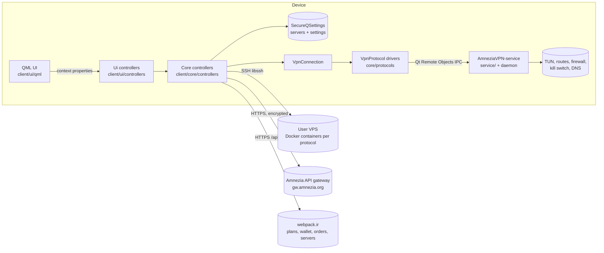

# CoCo VPN Architecture

Updated: 2026-11-14 (from `main` at `78f3302`). When this document and the code disagree, the code
wins: fix this document in the same change.

## 1. What the product is

CoCo VPN is a cross-platform VPN client (Windows, macOS, Linux, Android, iOS) that is a fork of the
open-source [Amnezia VPN Client](https://github.com/amnezia-vpn/amnezia-client), version 5.0.3.1
(`AMNEZIAVPN_VERSION` in `CMakeLists.txt`). It does two jobs:

1. **Connect** a device to a VPN (OpenVPN, OpenVPN over Cloak / ShadowSocks, WireGuard, AWG
   (AmneziaWG, two variants), XRay (VLESS REALITY), IKEv2 on Windows, Shadowsocks over XRay).
2. **Manage a self-hosted server**: from SSH credentials, the app installs each protocol as a Docker
   container on the user's own Linux VPS, then creates, renames, revokes and shares client configs.

CoCo-specific work (since the source snapshot of 2026-09-27, commit `323d8eb`) is mostly in the
second job: **batch account creation** with several protocols per account, **share templates**
(HTML / TXT with tags, a guided Persian RTL page per protocol, QR codes), Persian and English only,
the CoCo brand, and a Windows-only CI build. The primary test platform is Windows.

## 2. Repository layout

| Path | What it holds |
|---|---|
| `client/` | The app: C++17 / Qt 6.10 / QML. Everything below is under it unless noted. |
| `client/main.cpp`, `amneziaApplication.*` | Process entry, single-instance check, `QQmlApplicationEngine`, creates `CoreController`. |
| `client/core/controllers/` | Business controllers (no QML). `coreController.*` is the composition root that builds every repository, controller and model and registers them as QML context properties. |
| `client/core/controllers/selfhosted/` | Self-hosted server management: `installController` (install / remove containers over SSH), `exportController` (create client configs), `importController` (parse configs, keys, links), `usersController` (the server's `clientsTable`). |
| `client/core/controllers/api/` | Amnezia commercial service ("Amnezia Premium / Free"): subscriptions, store purchase, services catalog, news. Talks to `gatewayController`. |
| `client/core/controllers/webpack/` | CoCo's webpack.ir client (`docs/integration/WEBPACK.md`): `webpackApiClient` (`/api/v1` envelope, token refresh), `webpackSession` (device sign-in, PKCE loopback for Google), `webpackDeviceKey` (this device's Ed25519 key), `webpackShop` (plans, wallet, top-up checkout, balance polling), `webpackPurchases` (order with an idempotency key kept until a definite answer, build tracking), `webpackServers` (account servers and their SSH access), `webpackSudoSetup` (one-time passwordless sudo), `webpackIntegration` (owns them all). QML sees them through `WebpackUiController` (`WebpackController`). |
| `client/core/controllers/gatewayController.*` | Encrypted HTTP client for the Amnezia API gateway (RSA + AES, proxy fallback through S3 lists). |
| `client/core/configurators/` | Build a client config per protocol (`awgConfigurator`, `xrayConfigurator`, ...). |
| `client/core/installers/` | Per-container install steps (`awgInstaller`, `xrayInstaller`, `sftpInstaller`, ...). |
| `client/core/protocols/` | Runtime VPN protocol drivers on the device (`VpnProtocol` subclasses). |
| `client/core/models/` | Plain data: server descriptions, container / protocol configs, API configs. |
| `client/core/repositories/` | `SecureServersRepository` (the saved servers) and `SecureAppSettingsRepository` (app settings), both over `SecureQSettings` (encrypted settings, keychain-backed key). |
| `client/core/utils/` | Enums (`containerEnum.h`, `protocolEnum.h`, `errorCodes.h`), SSH (`selfhosted/sshClient`, `sshSession`), `scriptsRegistry` (server script lookup), serialization of share links (`serialization/`: vless, vmess, trojan, ss), QR codes, IPC client, migrations. |
| `client/ui/controllers/` | QML-facing controllers (`*UiController`). They adapt core controllers to QML; QML names differ (see `docs/ai/CODE_MAP.md` §1). `selfhosted/exportUiController` holds CoCo's account groups and share templates. |
| `client/ui/models/` | `QAbstractListModel`s for QML (servers, containers, protocol settings, API models). |
| `client/ui/qml/` | QML UI: `main2.qml`, `Pages2/` (one file per page, `Page<Name>.qml`), `Components/`, `Controls2/` (design-system controls), `Config/GlobalConfig.qml`, `qml.qrc`. |
| `client/ui/share/` | CoCo share templates (HTML parts: `document.html` wrapper, `account.html`, one guide per protocol). Bundled through a qrc. |
| `client/server_scripts/` | Bash scripts the app runs on the VPS over SSH: host preparation (`prepare_host.sh`, `install_docker.sh`, `setup_host_firewall.sh`) and one folder per container (`Dockerfile`, `configure_container.sh`, `run_container.sh`, `start.sh`, templates). Bundled by `serverScripts.qrc`; `$VARS` placeholders come from `scriptsRegistry` (`genBaseVars`, `gen<Protocol>Vars`) and are filled by `SshSession::replaceVars`. |
| `client/platforms/` | OS code: `windows/` (daemon, firewall, split tunnel, WireGuard tunnel service), `macos/`, `linux/`, `android/`, `ios/`, `dummy/`. |
| `client/daemon/`, `client/mozilla/` | WireGuard daemon and network-watcher code taken from Mozilla VPN. |
| `client/android/` | Android app (Kotlin/Java, Gradle): `VpnService`, AWG / OpenVPN / XRay modules, billing. |
| `client/ios/`, `client/macos/` | Swift / Objective-C, Network Extension for iOS and macOS NE. |
| `client/translations/` | Qt `.ts` files. Only `amneziavpn_fa_IR.ts` is compiled (English is the source text); the others remain in source unused. |
| `client/tests/` | Qt Test executables (CTest), built with `-DAMNEZIA_BUILD_TESTS=ON`. |
| `service/` | Privileged background service (`AmneziaVPN-service`): routes, kill switch, TUN, DNS, XRay process, TAP driver on Windows. |
| `ipc/` | Qt Remote Objects interfaces (`ipc_interface.rep`, `ipc_process_interface.rep`) between the client and the service. |
| `common/` | Code shared by client and service (logger, crypto utils). |
| `recipes/`, `conanfile.py`, `cmake/` | Conan 2 recipes for native dependencies (OpenVPN, OpenSSL, libssh, awg-*, xray bindings, tun2socks, wintun, ...), CMake platform settings, packaging (CPack, signing). |
| `deploy/` | `build.sh` / `build.bat` (the only supported build entry points), installer scripts (Qt IFW, WiX), OS service files. |
| `.github/workflows/` | `windows-build.yml` (CoCo's working build, on push to `main`), `deploy.yml` / `tag-*.yml` (inherited from upstream, multi-platform, currently failing on branches; see KNOWN_ISSUES), `graphify.yml`, `ai-docs.yml`. |
| `docs/` | This documentation set (`docs/ai/`, `docs/integration/`, `ROADMAP.md`) and upstream PlantUML workflows. |

## 3. Runtime model

- **Composition root.** `CoreController` (`client/core/controllers/coreController.cpp`) creates the
  repositories, core controllers, UI controllers and models, wires their signals
  (`coreSignalHandlers.cpp`) and registers them with `setQmlContextProperty`. There is no DI
  container; a new controller is added there.
- **Two controller layers.** Core controllers hold logic and are testable without QML; UI
  controllers expose `Q_PROPERTY` / `Q_INVOKABLE` / slots to QML and translate errors. Keep new
  logic in `core/` and keep UI controllers thin (CoCo's `ExportUiController` does not yet follow
  this; see KNOWN_ISSUES KI-04).
- **Navigation.** `PageController.goToPage(PageEnum.X)` loads `client/ui/qml/Pages2/X.qml`
  (`PageLoader::PageEnum` in `client/ui/utils/pageEnum.h`; the file must also be in `qml.qrc`).
- **Desktop privilege split.** The UI process is unprivileged. Anything needing root or admin
  (routes, TUN, firewall, kill switch, DNS, starting XRay) is a slot on `IpcInterface`
  (`ipc/ipc_interface.rep`) implemented in `ipc/ipcserver.cpp` inside the service. WireGuard and AWG
  on desktop go through the Mozilla-derived daemon (`client/daemon/`, `platforms/*/daemon/`).
- **DNS tunnel (CoCo, `DockerContainer::Dnstt`).** Server: container `amnezia-dnstt` = dnstt-server on UDP 53
  (published on the default-route address only) in front of a loopback VLESS inbound; it reuses
  `XrayProtocolConfig` (with a `dnstt` block), `XrayConfigurator` and `XrayInstaller` (subclass
  `DnsttInstaller`). Desktop: `DnsttProtocol` routes the chosen resolver around the tunnel, starts the
  unprivileged `dnstt-client` (Conan recipe `recipes/dnstt`, installed beside `tun2socks` on Windows) and wraps an
  `XrayProtocol` pointed at it; the service skips the uplink socket binding for loopback-only XRay configs.
  Android: `VpnProto.DNSTT` runs `Dnstt.kt` (xray module) in the XRay service process; it starts `dnstt-client`
  (shipped as `libdnstt.so` in that module's jniLibs) as a child process, keeps CoCo's own app out of the VPN
  so the child's queries bypass the tunnel, and hands `Xray.instance` the config pointed at the local port.
  Rules shared by all of these: `core/utils/dnstt/dnsttUtils`. Plan: `docs/plans/D1-dns-tunnel.md`.
- **Mobile.** Android runs the tunnel in `client/android` (`AmneziaVpnService.kt`), iOS and macOS NE in
  a Network Extension (`client/ios`, `client/platforms/ios`); `androidVpnProtocol.cpp` and the iOS
  controller bridge from C++.
- **Persistence.** All state is local: `SecureQSettings` (`client/secureQSettings.*`) encrypts values;
  the key lives in the OS keychain (qtkeychain submodule). Keys of note: servers (`Servers/...` via
  `SecureServersRepository`), `Conf/gatewayEndpoint`, and CoCo's `Sharing/accountGroups`,
  `Sharing/templates`, `Sharing/templateDefaults` (JSON, written by `ExportUiController`), and the
  encrypted `Webpack/*` keys (`session` holds only the refresh token and profile, `deviceKey`,
  `purchases`, `servers`; `Webpack/baseUrl` is plain). `Webpack/*` is not part of backups. A server
  may carry `cocoHostKeySha256`: `sshClient` then refuses a host key that does not match. Settings
  migrations: `client/core/utils/migrations.cpp`.

## 4. Main flows

| Flow | Path through the code |
|---|---|
| Add a self-hosted server | `PageSetupWizardCredentials.qml` -> `InstallController` (QML) = `InstallUiController` -> `core/controllers/selfhosted/installController` -> `sshClient` runs `server_scripts/prepare_host.sh`, `install_docker.sh`, then per container `build_container.sh` + `<container>/configure_container.sh` + `run_container.sh` -> the server is saved through `SecureServersRepository`. |
| Connect | `ConnectButton.qml` -> `ConnectionController` (QML) = `ConnectionUiController` -> `connectionController` -> `VpnConnection` -> a `VpnProtocol` subclass -> IPC to the service (desktop) or the platform VPN service (mobile). |
| Create one client config | `PageShare.qml` -> `ExportController` (QML) = `ExportUiController` -> `core/.../exportController` -> the protocol's configurator adds the peer / user on the server over SSH and `usersController` updates the server's `clientsTable`. |
| Batch accounts (CoCo) | `PageShare.qml` -> `ExportUiController::startAccountBatch` -> `createNextBatchAccount` (one account and protocol per step; each step runs `ExportController::generate*Config` and `UsersController::appendClient` on a private instance in a `QtConcurrent` worker, `handleBatchResult` updates the group on the GUI thread; `cancelAccountBatch` stops before the next step) -> group saved to `Sharing/accountGroups`. |
| Share templates (CoCo) | `PageSettingsShareTemplates.qml` and `PageShare.qml` -> `ExportUiController` (`upsertShareTemplate`, `renderAccountsWithTemplates`, `openHtmlPreview`); the parts come from `client/ui/share/*.html`; tags are replaced in one pass. |
| Buy a server (CoCo, webpack.ir) | `PageSetupWizardConfigSource.qml` -> `PageWebpackShop.qml` -> `WebpackController` = `WebpackUiController` -> `webpack::Shop` (plans, wallet; for a shortfall a checkout opened in the system browser and the balance polled) -> `webpack::Purchases::placeOrder` (wallet payment with this device's key and a CoCo-made login) -> order and `/access` polled until installed -> `PageWebpackServers.qml` Config -> `webpackSudoSetup` (host key pinned, `webpack_grant_sudo.sh`) -> `InstallUiController::setProcessedServerCredentials` -> `PageSetupWizardEasy` (the normal install). |
| Import | Text key, file, QR or `vpn://` link -> `ImportController` (QML) = `ImportUiController` -> `core/.../importController` (also parses vless/vmess/ss/trojan through `utils/serialization`). |
| Amnezia Premium / Free | `PageSetupWizardApiServicesList.qml` and the `PageSettingsApi*` pages -> `SubscriptionUiController` / `ServicesCatalogUiController` -> `core/controllers/api/*` -> `GatewayController` -> `gw.amnezia.org` (default in `secureAppSettingsRepository.cpp`). Update checks use the same gateway (`updateController.cpp`). |

## 5. Build

Only through `deploy/build.sh` (Linux, macOS, Android, iOS) or `deploy\build.bat` (Windows). They run
CMake with the Conan provider (`cmake/conan_provider.cmake`), which builds the native recipes on the
first run (slow). Requirements: CMake 3.25+, Qt 6.10 with `qtremoteobjects qt5compat qtshadertools`,
Conan 2.28, a compiler for the target (MSVC 2022 on Windows), Go for some recipes, and
`git submodule update --init --recursive` (qtkeychain, SortFilterProxyModel, qtgamepad,
amneziawg-apple). The Windows CI build (`.github/workflows/windows-build.yml`) is the reference:
`deploy\build.bat --installer ifw` produces `deploy/build/CoCoVPN_*_windows_x64.exe`. Build-time
secrets (`PROD_AGW_PUBLIC_KEY`, `*_S3_ENDPOINT`, `DEV_AGW_ENDPOINT`, `FREE_V2_ENDPOINT`,
`PREM_V1_ENDPOINT`) are compiled in as defines (`client/CMakeLists.txt`); empty values only disable
the Amnezia gateway features.

The app's internal names are still Amnezia's (`PROJECT AmneziaVPN`, `AmneziaApplication`,
`amnezia::` namespace, `AmneziaVPN-service`, translation file names). The brand is set in
`client/cmake/branding/common.cmake`, installer scripts, `metadata/` and `.rc.in` files. Do not rename
internal identifiers: it would make every upstream merge conflict.

## 6. Relationship to upstream

- The repository started as a snapshot (`323d8eb Import CoCo VPN source snapshot`) without upstream
  history, so `git merge upstream/dev` does not work. To take an upstream fix, diff the upstream
  release tag against the snapshot's base version (5.0.3.1) and apply the relevant hunks, or cherry-pick
  by patch. Record each upstream sync in `CHANGELOG.md`.
- Keep CoCo changes in new files or clearly bounded blocks where possible (new pages, new
  controllers, `client/ui/share/`), and keep upstream files' structure, to keep that diff small.
- Licence: GPL-3.0 (inherited). Distributed builds must publish their source.

## 7. Rules that follow from the architecture

1. QML never holds business logic or persistence; it calls a UI controller.
2. A UI controller never talks SSH, the network or `SecureQSettings` directly for new features;
   it calls a core controller or repository (existing CoCo code is the exception being drained, KI-04).
3. Every privileged action on desktop is an `IpcInterface` slot, never a direct system call from the
   UI process.
4. Server-side changes go in `client/server_scripts/`, never as command strings built from user
   input in C++. Values reach scripts as `$VAR` placeholders (`scriptsRegistry`, `SshSession::replaceVars`).
5. Secrets (SSH passwords, private keys, client configs) are stored only through `SecureQSettings`
   and never logged (`common/logger` writes user-visible log files).
6. User-facing text is `qsTr()` / `tr()` with a Persian translation in `client/translations/amneziavpn_fa_IR.ts`;
   layouts must work right-to-left.
7. New network services (for example webpack.ir) get their own client class under
   `client/core/controllers/` and their own settings keys, not new branches inside `GatewayController`
   (see `docs/integration/WEBPACK.md`).
