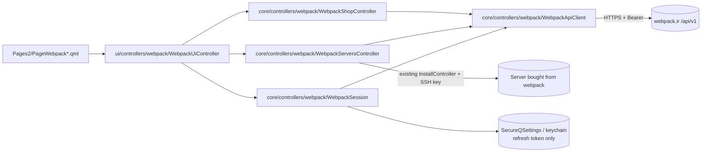

# Integration with webpack.ir (Iranux-Bash-Runner)

Status: design, nothing implemented. Written 2026-11-14 from a read-only review of
`Iranux-Master/Iranux-Bash-Runner` at `a7f6911` (branch `Develop`). That repository is read-only
from CoCo work: when its behaviour matters, read its documents (paths below), and put anything CoCo
needs from it in §7 as a request for that project.

## 1. What webpack.ir is

webpack (وب‌پک, `https://webpack.ir`, also `webpack.site`) is a .NET 10 platform from the same owner:
a white-label VPS reseller (Webdock underneath, never named to clients) with sign-up, a wallet
(toman, USD or EUR; ZarinPal, Stripe, PayPal, NOWPayments), monthly renewal, a setup wizard that
installs apps from the Just-Bash script catalog (Iranux Script Specification v1.2), web terminal and
file manager, notifications, and an admin panel. Its desktop app (Iranux / webpack for Windows,
macOS, Linux) already signs in to the site and manages "servers bought from webpack" over a typed
client; CoCo should follow the same path.

Sources in that repository: `AGENTS.md`, `ARCHITECTURE.md`, `docs/ai/API_REFERENCE.md` (every
endpoint), `docs/ai/FEATURE_MATRIX.md` (what works), `docs/modules/Servers.md`, `Accounts.md`,
`Setup.md`, `Billing.md`, `Payments.md`, the DTOs in `BashScriptRunner.Api.Contracts/`, and the
reference client in `BashScriptRunner.Client/` (`IWebpackApi.cs`, `Session/DeviceSessionManager.cs`,
`Session/LoopbackReceiver.cs`) and `BashScriptRunner.Ui/Services/PlatformServerDirectory.cs`.

## 2. API facts CoCo depends on

| Topic | Behaviour (from `docs/ai/API_REFERENCE.md` §1) |
|---|---|
| Base | `https://webpack.ir/api/v1` (configurable; only HTTPS, or HTTP on loopback for development, as `WebpackClientOptions.IsAllowedBaseAddress` does) |
| Auth | `Authorization: Bearer wpa_…` device access token (15 min) with a rotating `wpr_…` refresh token (30 days; a replayed refresh ends the session). At most 10 sessions per account. A password change, "sign out everywhere" or a suspension ends every device. |
| Envelope | `ApiResult<T> { success, data, error { code, message, validationErrors? }, correlationId }`; paging `PagedResult<T> { items, page, pageSize, totalCount }` |
| Errors | 400 / 401 `invalid_token` / 402 / 403 `password_change_required` / 404 / 409 with a stable `code`; 429 on rate limits (60 per minute per caller for most routes; device sign-in 5 per minute per IP) |
| IDs | Only public ids (`server_…`, `plan_…`, `order_…`, ...). Provider names never appear. |
| Correlation | Send `X-Correlation-ID` (1 to 64 letters, digits, hyphens) and log it, so a support case can be traced on both sides. |

Endpoints CoCo would use (all exist today):

| Purpose in CoCo | Endpoint |
|---|---|
| Sign in with email and password | `POST /auth/device-sessions` `{ email, password, deviceName }` |
| Sign in with Google | `POST /auth/device-sessions/google` `{ deviceName, codeChallenge, redirectPort }` -> system browser -> one-time code on `http://127.0.0.1:<port>/webpack-signin` -> `POST /auth/device-sessions/google/exchange` `{ requestId, code, codeVerifier }` |
| Refresh, profile, sign out | `POST /auth/device-sessions/refresh`, `GET /auth/device-sessions/current`, `DELETE /auth/device-sessions/{id}` |
| My servers | `GET /vps/servers`, `GET /vps/servers/{id}` (ip, sshPort, location, image, plan), `GET /vps/servers/{id}/capabilities` |
| SSH access from this device | `GET /vps/ssh-keys`, `POST /vps/ssh-keys` `{ name, publicKey }`, `PUT /vps/servers/{id}/access/key` `{ sshKeyPublicId }`, `GET /vps/servers/{id}/access` (`loginUsername`, `installState`, `clientKeyFingerprint`, `hostKeySha256`) |
| Power and health | `POST /vps/servers/{id}/actions/{start,stop,reboot}`, `GET /vps/servers/{id}/metrics` (CPU, memory, disk, monthly traffic and its % of the allowance) |
| Buy a server | `GET /vps/plans`, `POST /vps/orders` (with `idempotencyKey`, `expectedAmount`, `expectedCurrencyCode`), `GET /vps/orders/{id}` |
| Wallet | `GET /wallet/balance`, `GET /wallet/transactions`; top-up stays on the website (`POST /wallet/payment-checkouts` returns a `checkoutUrl` for the browser) |
| Renewal | `GET /billing/invoices`, `PUT /billing/servers/{id}/auto-renew` |
| Notices | `GET /notifications`, `/notifications/unread-count`, `POST /notifications/{id}/read`, `/read-all` |
| Apps from the catalog | `GET /catalog/scripts`, `POST /vps/servers/{id}/build-jobs`, `GET /vps/build-jobs/{id}` (see §5.6 for why CoCo should not use this for its VPN protocols yet) |

## 3. Design inside CoCo

- **`WebpackApiClient`** (new, `client/core/controllers/webpack/`): one `QNetworkAccessManager`,
  base URL from settings (`Webpack/baseUrl`, default `https://webpack.ir/`), JSON envelope parsing
  into `{ ok, data, errorCode, message, httpStatus, correlationId }`, `X-Correlation-ID` per call,
  bearer header, one automatic refresh and retry on 401, `Retry-After` on 429, a timeout per call
  (orders longer, as the reference client's 120 s). It does not reuse `GatewayController`, whose
  RSA/AES envelope and proxy logic belong to Amnezia's gateway.
- **`WebpackSession`**: sign-in (password and Google PKCE with a `QTcpServer` on `127.0.0.1` that
  accepts one request on `/webpack-signin`, 10-minute cap, never follows a redirect), refresh,
  sign-out, the cached profile (`GET /auth/device-sessions/current`). Stores only the refresh token
  and the profile, through `SecureQSettings` (keys under `Webpack/`); never the password or the access
  token. Device name: `CoCo VPN · <OS> · <host name>`.
- **`WebpackServersController`**: lists the account's servers, their state, capabilities, metrics,
  power actions, and "Set up access" (§4 flow F2). Produces a normal CoCo `ServerCredentials` so the
  existing install, connect and share flows work unchanged.
- **`WebpackShopController`**: plans, order with a kept idempotency key, order polling, wallet
  balance; top-up opens the website.
- **UI**: a "webpack account" section in settings, a "Servers bought from webpack" group in the
  servers list, and a server-buying page. Persian first, RTL, the same words as the webpack desktop
  app where possible (its strings are in `BashScriptRunner.Ui/Services/UiStrings.Platform.cs`).
- The account is optional: CoCo keeps working fully without it.

## 4. Flows

### F1. Sign in

1. Email and password -> `POST /auth/device-sessions`. Map the refusals to plain Persian messages
   (`invalid_credentials`, lockout, `password_change_required` opens the website account page,
   unconfirmed email, unapproved account, unreachable site).
2. Or Google: make a PKCE verifier and S256 challenge, open a loopback listener on a free port,
   `POST /auth/device-sessions/google`, open the returned URL in the system browser, wait for the
   code, exchange it. Hide the button for the run when the site answers `google_unavailable`.
3. Keep the refresh token; refresh at start and before expiry; on `invalid_token` from refresh,
   sign out locally and say so.

### F2. Use a server bought from webpack in CoCo (the main integration)

1. `GET /vps/servers` and `/vps/servers/{id}`; show state in words.
2. "Set up access": create this device's Ed25519 key once (libssh `ssh_pki_generate`, private key in
   `SecureQSettings`), `GET /vps/ssh-keys`, add it with `POST /vps/ssh-keys` unless the fingerprint is
   there, then `PUT /vps/servers/{id}/access/key`. Poll `GET /access` until `installState` is
   `installed` and `clientKeyFingerprint` matches.
3. Pin the host key to `hostKeySha256` from `/access` (do not connect until it is set; a mismatch
   stops, never re-pins silently).
4. Build `ServerCredentials { hostName = ipAddress, port = sshPort, userName = loginUsername, key }`
   and hand it to the existing setup wizard (`InstallController`), which installs AWG / XRay /
   WireGuard / OpenVPN containers exactly as today. Batch accounts and share templates then work on
   that server unchanged.
5. CoCo's installer needs passwordless sudo (`check_user_in_sudo.sh` runs `sudo -n`). For servers
   bought in CoCo, CoCo chose the password and installs a `NOPASSWD` sudoers file on first Config
   (plan `W5-buy-vps-in-app.md`). For servers bought on the website: CoCo's installer runs `sudo`. The platform's sudo password never reaches devices
   (webpack `docs/modules/Servers.md`); the login password the person chose or saw at purchase is the
   sudo password. CoCo asks for it once per install (not stored, or stored only with consent), unless
   webpack adds a request in §7.

### F3. Buy a server from CoCo

Planned in detail in `docs/plans/W5-buy-vps-in-app.md`. In short: plans and review in the app; the
order is paid from the wallet (`POST /vps/orders` has no other way to pay); when the wallet is short,
CoCo opens `POST /wallet/payment-checkouts` for the exact shortfall in the **system browser** (never an
embedded web view) and polls `GET /wallet/balance` until it covers the price, then orders by itself.
The order carries this device's `sshKeyPublicId` and a CoCo-generated `loginUsername` /
`loginPassword`, so the key is installed at build time and CoCo knows the sudo password. The idempotency
key is kept until a definite answer (port of webpack's `OrderAttempt.cs`). CoCo then polls the order and
`/access` until the server is ready, and continues with F2 (sudo bootstrap, pinned host key, install).

### F4. Server health in CoCo

The server page shows CPU, memory, disk and monthly traffic (`/metrics`), and the power actions that
`/capabilities` allows (`locked` ones as "enabled by support"). Useful for VPN operators: traffic
near the allowance is the most common reason a VPN stops.

### F5. Notices and renewal

Poll `GET /notifications/unread-count` every few minutes while signed in (the desktop app uses 2
minutes), show renewal and expiry notices in the tray, and link each notice's `link` to the website.
Before a server expires, the server card says so and offers auto-renew (`PUT /billing/.../auto-renew`).

### F6. Why not install VPNs through webpack build jobs (yet)

The catalog has `wireguard`, `openvpn`, `xray-reality`, `x-ui`, `hysteria2`, `outline-server`,
`shadowsocks-rust`, `sing-box-tuic` scripts, but:

- their client links and files are written only to root-only files on the server, because no
  `IRANUX_RESULT` output may carry a secret (webpack KNOWN_ISSUES KI-105), so CoCo could not import
  them over the API;
- they are not CoCo's Docker containers, so CoCo's client management (`clientsTable`, revoke,
  rename, batch accounts) would not see them, and their ports can collide with CoCo's.

So CoCo keeps its own installer for VPN protocols on webpack servers (F2). Later options: a
"coco-vpn-server" Iranux-compatible script in Just-Bash that runs CoCo's container setup, so the web
wizard can prepare a server that CoCo then manages; or a one-time secret result type on webpack's side
(§7).

## 5. Security rules for the integration

- Never log access or refresh tokens, passwords, private keys or the `Authorization` header; log
  the correlation id and the error code only.
- Only the public half of the device key leaves the device. Host keys are pinned from `/access`.
- HTTPS only (loopback HTTP only in development builds); no TLS bypass; no proxy fallback lists.
- Honour 429 and back off; never retry `POST /vps/orders` with a new idempotency key after an unclear
  answer.
- Show webpack's user-facing messages, not raw server errors; never show internal ids beyond the
  public ones.
- The account and its data stay optional and removable ("Sign out" deletes the refresh token, the
  device key's account entry stays until the person removes it on the website).

## 6. Phased plan

| Phase | Scope | Depends on |
|---|---|---|
| W0 | `WebpackApiClient`, settings keys, health check (`GET /health/ready` is outside `/api/v1`) and a hidden developer page | nothing |
| W1 | Sign-in (password, then Google), account chip, sign-out, device list link | W0 |
| W2 | "Servers bought from webpack" list, state, metrics, power actions | W1 |
| W3 | "Set up access" + hand-off to the install wizard (F2) | W2, the sudo answer in F2 step 5 |
| W4 | Notices and renewal (F5) | W1 |
| W5 | Buy a server natively (F3; plan `docs/plans/W5-buy-vps-in-app.md`) | W1, device key + host-key pin |
| W6 | Replace or hide the Amnezia Premium / Free flows (KNOWN_ISSUES KI-01) with webpack offers | owner decision |

## 7. Requests for the webpack project (do not implement from CoCo)

1. **Sudo for device-run installs.** A way for a signed-in device to run privileged installs on its
   own server without the person typing the login password (for example a per-device sudoers rule
   installed with the device key, scoped and audited), or an explicit decision that devices always ask.
2. **A product tag on device sessions** (for example `deviceKind: "coco-vpn"`) so the Security tab and
   analytics can tell CoCo from the webpack desktop app.
3. **Update feed for CoCo** (signed JSON with version, URL and SHA-256 per platform) hosted by
   webpack or `iranux.site`, to replace the Amnezia gateway's update data (CoCo KI-02).
4. **One-time secret results** (webpack KI-105), if VPN installs through build jobs should ever feed
   CoCo.
5. **VPN-ready plans**: a plan or region flag that says traffic allowance and whether UDP ports are
   open, so CoCo can recommend a plan for VPN use.
6. **Staging base URL** for CoCo development with fake payments.
7. **Payment intent status (R7):** `GET /wallet/payment-intents/{id}` with `pending`, `verified`,
   `credited`, `failed`, `cancelled` or `expired`, so a device stops waiting exactly (today: balance polling).
8. **Device return page (R8):** `returnTo: "app"` on `POST /wallet/payment-checkouts`, so the gateway
   return lands on a sign-in-free "payment received, return to CoCo" page (or a loopback port) instead
   of `/wallet`, which may ask the browser to sign in.
9. **Gateways for the caller (R9):** `GET /wallet/payment-gateways` with the live gateways for the
   wallet currency and their minimum and maximum amounts.
10. **Sudo facts in `/access` (R10):** a `sudoMode` (`password` or `nopasswd`) field, or a documented
    guarantee of how a purchased login's sudo behaves.
11. **VPN suitability per plan and system (R11, extends 5):** traffic allowance, UDP open, Docker
    support per operating system.
