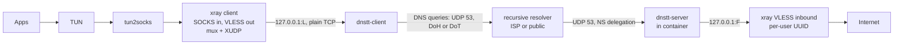

# Plan: DNS tunnel protocol for heavy censorship (D1)

Written 2026-11-16 from PR #3's branch (`claude/project-thread-4o25d8`) and a read-only review of
`Iranux-Master/Iranux-Bash-Runner` at `06964f6` (`Develop`): the catalog tool `dnstt`
(`tools/catalog-seed/specs/dnstt.json`, `tools/catalog-seed/bodies/dnstt.sh`, tests in
`BashScriptRunnerBlazor.Tests/ToolCatalogSeedTests.cs`).

**Status (2026-11-16):** slices 1 and 2 are implemented in PR #4 (server container, wizard, Windows client); what
they left open is KNOWN_ISSUES KI-15. Two choices differ from the text below: the container keeps XRay's own
paths (`/opt/amnezia/xray/server.json`, `xray_uuid.key`) so `XrayConfigurator` and the users table work unchanged,
and the device uses the first configured resolver instead of probing a list.

## Goal

A new protocol **"DNS tunnel"** in the CoCo protocol list, for the days when only DNS still works
(international links shut down or throttled to the point where AWG, XRay REALITY and OpenVPN fail,
but the ISP's recursive resolvers still resolve foreign names). The operator picks it in the wizard
like any other protocol, gives a tunnel subdomain, and CoCo installs it as a Docker container on the
VPS. CoCo itself is the client: one press connects, the whole device goes through the tunnel, and
batch accounts and share templates work as for XRay.

It is a **last-resort** protocol: dnstt through public resolvers carries tens to a few hundred
kilobits per second with high latency. It is for messaging, mail and light browsing, not video.

Out of scope for the first slices: iOS and macOS Network Extension, Linux packaging (KI-09), creating
the DNS records automatically through webpack (a request in §"Requests to webpack"), and other DNS
tunnels (slipstream, iodine), which can be added later behind the same client design.

## Current state

- webpack's library has dnstt as a catalog tool: dnstt `20260501` (David Fifield, CC0 public domain),
  built from pinned source with a pinned Go toolchain, run as a hardened systemd service on host UDP
  53, forwarding to a local TCP port (SSH by default). The person then runs `dnstt-client` by hand and
  `ssh -D` for SOCKS. Its tests check the script metadata, the risk level (`dangerous`) and the NS +
  glue records it declares (`t.example.com NS t-ns.example.com`, `t-ns.example.com A <server IP>`);
  they do not run a tunnel. There is no per-user access control: anyone with the public key reaches
  the forwarded port.
- The same module is on the Go module proxy as `www.bamsoftware.com/git/dnstt.git v1.20260501.0`, so
  it can be fetched with `go.sum` and sumdb verification (the bamsoftware.com zip URL is not always
  reachable from build hosts).
- CoCo: a protocol is a server container plus a device-side `VpnProtocol` (skill
  `.claude/skills/add-vpn-protocol/SKILL.md`). The closest model is **SSXray**: its own container and
  `Proto`, but the device side reuses `XrayProtocol` (`client/core/protocols/vpnProtocol.cpp:122`).
- Desktop XRay path (`client/core/protocols/xrayProtocol.cpp`): xray-core runs in the privileged
  service (`IpcServer::xrayStart`, `service/server/xray.cpp`, whose socket callback binds xray's own
  sockets to the physical interface), `tun2socks` (a `PermittedProcess`) feeds the TUN into xray's
  SOCKS inbound, then routes `0/1`-style subnets to the TUN; the kill switch and Windows split
  tunnelling exempt `vpnServer` = the server address.
- Android XRay path (`client/android/xray/src/main/kotlin/Xray.kt`): libXray (gomobile AAR built by
  `recipes/amnezia-libxray`) runs xray and tun2socks in the VPN service process and protects its
  sockets with `VpnService.protect`.
- Go is already a build tool of the Conan graph (`tool_requires("go/1.26.0")` in
  `recipes/tun2socks`, `recipes/amnezia-libxray`), so building a Go client adds no new toolchain.
- Host UDP 53 on the VPS: the Amnezia DNS container uses only the Docker network
  `amnezia-dns-net` (`client/server_scripts/dns/run_container.sh`), so CoCo itself does not hold it;
  systemd-resolved's stub listens on `127.0.0.53:53` on Ubuntu.

## Design

### Data path

Why xray inside the tunnel and not SSH or a bare SOCKS port (as the webpack tool suggests):

1. **Accounts.** dnstt has one server key and no client authentication. A VLESS UUID per account
   gives CoCo's batch accounts, revocation and `clientsTable` the same model as XRay.
2. **UDP and DNS.** tun2socks sends UDP as SOCKS UDP ASSOCIATE, which cannot cross a TCP-only
   tunnel. VLESS carries UDP over the stream (XUDP), so the device's DNS and UDP apps keep working.
3. **Efficiency.** xray mux puts every connection on one dnstt stream, so a new TCP connection costs
   no extra round trips through the slow DNS path. No TLS or REALITY inside (Noise already encrypts
   and authenticates the server), which saves kilobytes per connection.
4. **Reuse.** The device side is the existing, tested XRay client on every platform; only the
   dnstt-client step and one route are new.

### Server side: container `amnezia-dnstt`

- `DockerContainer::Dnstt`, `Proto::Dnstt`, config key `dnstt`, container name `amnezia-dnstt`,
  shown as "DNS tunnel" / «تونل DNS», VPN service, transport UDP, default port 53 (fixed).
- `client/server_scripts/dnstt/Dockerfile`: multi-stage. Stage 1 `golang:<pinned>-alpine` runs
  `go install www.bamsoftware.com/git/dnstt.git/dnstt-server@v1.20260501.0` (sumdb-verified, no
  `GOFLAGS=-insecure`); stage 2 is the same Alpine base and xray release as the XRay container, plus
  the `dnstt-server` binary.
- `configure_container.sh`: generates the dnstt key pair once (`dnstt-server -gen-key`, kept in
  `/opt/amnezia/dnstt/`, private key mode 600) and the first VLESS UUID; CoCo writes `server.json`
  (VLESS inbound on `127.0.0.1:$DNSTT_FORWARD_PORT`, `network: tcp`, `security: none`, decryption
  none, the same outbound and DNS rules as XRay) the way `XrayConfigurator::writeServerConfigForSetup`
  does.
- `run_container.sh`: publishes **only** `-p $DNSTT_LISTEN_IP:53:53/udp`, where `DNSTT_LISTEN_IP` is
  the source address of the host's default route (`ip -4 route get 1.1.1.1`). Binding the interface
  address instead of `0.0.0.0` avoids the clash with systemd-resolved's stub on `127.0.0.53`, so,
  unlike the webpack tool, CoCo never edits resolved or `/etc/resolv.conf`. It works behind cloud NAT
  because traffic arrives on that private address. Before running, the script fails with a clear
  message when anything already listens on UDP 53 on that address or on `0.0.0.0` (bind, dnsmasq, a
  webpack-installed dnstt). The host firewall rule for UDP 53 is added the way other containers'
  ports are.
- `start.sh`: `dnstt-server -udp :53 -mtu $DNSTT_MTU -privkey-file … $DNSTT_DOMAIN 127.0.0.1:$F`
  and `xray -config server.json`, iptables INPUT limited to lo and UDP 53, as the XRay `start.sh`.
- `DnsttInstaller` (or `XrayInstaller` with a switch, as SSXray) and `DnsttConfigurator` derived from
  the XRay configurator: a new client = a new VLESS UUID in `server.json` plus a reload; the client
  config carries the xray JSON and a `dnstt` block (`domain`, `pubkey`, default resolvers).
- Settings: tunnel domain (required, validated as in the webpack script: a subdomain whose parent is
  not a TLD, lower-cased, `^[a-z0-9]…$`), MTU of responses (default 1232, advanced). The install page
  shows the two records to add, exactly as webpack's result does (`NS t.example.com → t-ns.example.com`,
  `A t-ns.example.com → <server IP>`), with copy buttons, and a **Check delegation** button that asks a
  public resolver for `NS <domain>` and compares it.

### Device side

`DnsttProtocol : VpnProtocol` (`client/core/protocols/dnsttProtocol.{h,cpp}`) **wraps** an
`XrayProtocol` instead of changing it (upstream file untouched):

1. Choose the resolver (below) and resolve it to an IP `R`.
2. Pick a free local port `L`; start `dnstt-client -udp R:53 | -doh URL | -dot host:853 -pubkey K
   DOMAIN 127.0.0.1:L` as an unprivileged `QProcess`; wait for its listening line or a TCP accept on
   `L` (timeout 15 s, then `ErrorCode::DnsttClientFailed`).
3. Add a host route `R/32` via the physical gateway (`IpcInterface::routeAddList`), so the tunnel's
   own DNS queries never enter the TUN. On Windows the kill switch and split tunnel exempt it by
   passing `vpnServer = R`.
4. Build the inner configuration: a copy of the raw config with `hostName = R` (so XrayProtocol's
   exemptions point at the resolver) and the xray outbound set to `127.0.0.1:L`, VLESS, no TLS, mux
   on; create the inner `XrayProtocol` and relay its state and error signals.
5. Stop: inner `stop()`, then kill dnstt-client, then `routeDeleteList`. A dnstt-client crash stops
   the connection with an error, like tun2socks today.

dnstt-client binary: a Conan recipe `recipes/dnstt` (copy of `recipes/tun2socks`'s structure) builds
`dnstt-client` from the same module version with the Go already in the graph, and the deploy step
places it next to `tun2socks` (`Utils::executable("dnstt-client")`). Windows first (the tested
platform), then Linux and macOS by the same recipe.

Resolvers, in the protocol settings and in the client config: **Auto** (the device's current DNS
servers, UDP; in a shutdown the ISP's resolver is usually the only one that still reaches foreign
authoritative servers), a preset list (UDP and DoH/DoT of well-known public resolvers), or a custom
entry. Auto tries the list in order and keeps the first one that completes the Noise handshake.

Android: dnstt-client's `package main` cannot be imported, so a small Go package
`cocodnstt` (in `recipes/dnstt`, vendoring the client's CC0 files) exposes
`Start(domain, pubkey, transport, resolver, listen) / Stop()` and a dialer hook that calls
`VpnService.protect` on every socket. It is bound with gomobile into `dnstt.aar` and used by a
`Dnstt` Kotlin protocol that starts it before `Xray.instance`; `VpnProto.DNSTT` runs in the XRay
service process. This is the clean equivalent of step 3 (no route needed: protected sockets bypass
the VPN).

### Sharing

The share template protocol "DNS tunnel" with a guide part (`client/ui/share/dnstt.html`) that says
it is slow and for emergencies. The exported config is CoCo-only (a `coco://`-style JSON with the
xray config and the dnstt block); no other app can import it, which the guide says.

## Slices (one PR each, in order)

### 1. Server container and protocol plumbing  (size L, depends on: PR #3)
- Files: `containerEnum.h`, `protocolEnum.h`, `containerUtils.cpp`, `protocolUtils.cpp`,
  `configKeys.h`, `client/server_scripts/dnstt/*`, `serverScripts.qrc`, `scriptsRegistry.cpp`,
  `installers/dnsttInstaller.*`, `configurators/dnsttConfigurator.*`, `installController.cpp`,
  `configuratorBase.cpp`, protocol config model and serialization, `sources.cmake`.
- Tests: `bash -n` on every script; a Qt test that `containerFromString(containerToString(Dnstt))`
  round-trips and that a stored server list without dnstt still loads; manual install on a test VPS.
- Done when: the wizard lists "DNS tunnel", installs it, and `dig @<server> TXT x.<domain>` gets an
  answer from dnstt-server.

### 2. Windows client  (size L, depends on: 1)
- Files: `recipes/dnstt/conanfile.py`, `conanfile.py`, deploy copy step, `dnsttProtocol.*`,
  `vpnProtocol.cpp` factory, `errorCodes.h`, protocol settings page and model, `fa_IR` strings.
- Tests: Qt test for the inner-config rewrite (hostName = resolver, outbound = 127.0.0.1:L, mux on);
  manual Windows connect through UDP and DoH resolvers, with kill switch on and off.
- Done when: a Windows device connects, browses, and disconnects leaving no route behind.

### 3. Android client  (size L, depends on: 1)
- `cocodnstt` Go package + gomobile AAR, `client/android/dnstt/`, `VpnProto.DNSTT`, CI build.

### 4. Sharing and batch accounts  (size M, depends on: 2)
- `ExportUiController` per-container export, template protocol, `client/ui/share/dnstt.html`.

## Risks

| Risk | Likelihood | Impact | Mitigation |
|---|---|---|---|
| In a full shutdown the ISP resolvers stop resolving foreign domains, or UDP 53 to the VPS is cut | Medium | The tunnel does not work at all | Say so in the UI and guide; offer DoH/DoT and custom resolvers; keep AWG/XRay as first choices |
| DPI rate-limits or blocks long, high-entropy query names | Medium | Very low speed or drops | MTU setting, resolver rotation in Auto; later, slipstream as a faster alternative behind the same client design |
| UDP 53 on the VPS already used (bind, Pi-hole, webpack's dnstt tool) | Low | Install fails | Pre-check with a clear message; never stop another service |
| The provider or registrar refuses NS delegation for a subdomain, or the operator types the records wrong | Medium | Nothing reaches the server | Show both records with copy buttons; **Check delegation** before finishing; webpack auto-DNS later |
| Routing loop: dnstt queries entering the TUN | Medium if missed | Connection hangs | Host route for the resolver (desktop), `protect` (Android); test with kill switch on |
| Abuse: the public key is shared by all accounts | Low | Anyone can open dnstt sessions | dnstt alone reaches only the loopback VLESS port, which requires a UUID |
| Upstream merge conflicts | Low | Port work | New files for everything; the enum/utils edits are additive |

## Owner decisions

| Question | Options | Recommendation | Blocks slice |
|---|---|---|---|
| Inner protocol | VLESS (per-user, UDP) / SOCKS5 with password / SSH as in the webpack tool | VLESS | 1 |
| Where the domain comes from | Operator's own domain / webpack-hosted domain with automatic records | Own domain now, webpack later | - |
| First client platform | Windows / Android | Windows (only tested platform), Android right after | 2, 3 |

## Requests to webpack

- R12: an `/api/v1` endpoint that creates the NS + glue records for a tunnel subdomain on a domain the
  account hosts on webpack (the server side of spec 1.3 `dns` already exists for scripts), so CoCo can
  set up a DNS tunnel with no manual DNS step.

## Open questions for the implementer

- Whether `ContainerConfig` / `protocolConfig.cpp` persist containers by name (check
  `serverConfigUtils` and `containerFromString`) before appending the enum value.
- How the deploy step collects `tun2socks` from Conan (`deploy/`, `client/cmake/`), to place
  `dnstt-client` the same way.
