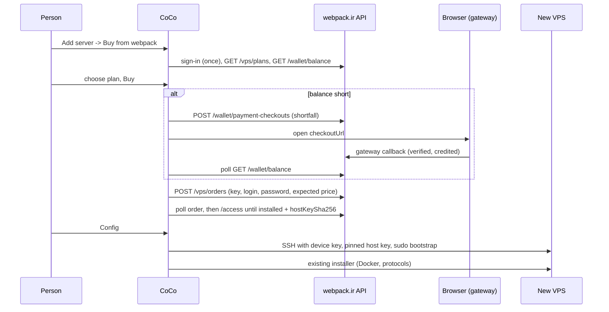

# Plan: Buy a webpack.ir VPS inside CoCo and configure it in one press (W0, W1, W3, W5)

Written 2026-11-14 from `main` at `78f3302` plus the AI docs of PR #1, and a read-only review of
`Iranux-Master/Iranux-Bash-Runner` at `06964f6` (`Develop`). Nothing here is implemented.

## Goal

In "Add server" the person presses **Buy a server from webpack**, signs in to webpack.ir (once per
device), sees the plans with prices in their wallet currency, picks plan, location and system, and
pays. When the wallet is short, CoCo opens the payment gateway for exactly the missing amount in the
system browser and continues by itself when the money arrives. After the order, CoCo tracks the
build, installs this device's SSH key on the new server through webpack, pins its host key, and lists
the server under **Servers bought from webpack** as "Ready to configure". Pressing **Config** runs the
existing CoCo setup (Docker + AWG / XRay / WireGuard / OpenVPN containers) with no password or IP to
type, and the server then works with batch accounts and share templates as any other.

Out of scope: renewals, notices, metrics and power actions (W2, W4, F4, F5); servers bought on the
website before (they get the same "Config" with one password prompt, slice 6); other platforms than
Windows (only Windows is built, KI-09); replacing the Amnezia Premium pages (KI-01, W6).

## Current state

- Add-server entry: `client/ui/qml/Pages2/PageSetupWizardConfigSource.qml` (the "Self-hosted VPN"
  item goes to `PageSetupWizardCredentials`; "CoCo VPN" still opens Amnezia's services list, KI-01).
- Install path: `InstallUiController::install` -> `InstallController::installServer`
  (`client/core/controllers/selfhosted/installController.cpp:1234`) runs in `QtConcurrent` and adds
  the server with `ServersRepository::addServer` (`:1285`). `ServerCredentials`
  (`client/core/utils/commonStructs.h:9`) is `{ hostName, userName, secretData, port }`; a private key
  in `secretData` is accepted (`sshClient.cpp:70`).
- **CoCo needs passwordless sudo.** `check_user_in_sudo.sh` runs `sudo -n`, and
  `InstallController` (`:920`) fails with `ServerUserPasswordRequired` when sudo asks for a password.
  Every server script calls `sudo` non-interactively.
- **CoCo never checks the SSH host key** (`client/core/utils/selfhosted/sshClient.cpp:33-105`:
  `ssh_connect` then auth, no `ssh_session_is_known_server` or fingerprint check). New KI-12.
- No HTTP client for webpack exists. `GatewayController` is Amnezia's encrypted gateway and must not be
  reused (`docs/integration/WEBPACK.md` §3). The build has Qt Network and OpenSSL 3; it has no Qt
  WebEngine or Qt WebView.
- webpack facts that decide the design (`API_REFERENCE.md` §1, §3.2, §3.3, §3.4b, `docs/modules/Servers.md` "Purchase"):
  - A device token (`wpa_…`, 15 min, rotating `wpr_…` refresh) holds every scope, orders and top-ups included.
  - `POST /vps/orders` pays **only from the wallet**. It takes `sshKeyPublicId`, `loginUsername`,
    `loginPassword`, `operatingSystemId`, `idempotencyKey`, `expectedAmount`, `expectedCurrencyCode`;
    402 `insufficient_balance`, 409 `price_changed`, `order_pending_review`, and the key rules that the
    Windows app implements in `BashScriptRunner.Ui/Services/OrderAttempt.cs`.
  - The login password chosen at purchase is both the SSH and the **sudo** password; webpack leaves
    sudo "as Webdock sets it" and itself always runs `sudo -S` with the password. Whether the login
    has passwordless sudo is not documented: assume it does not.
  - Top-up: `POST /wallet/payment-checkouts { amount, idempotencyKey, currencyCode?, gatewayCode? }`
    returns `checkoutUrl` and `expiresAtUtc`. The gateway returns to the website (`/wallet?topup=…`),
    not to a device, and there is no `GET` for a payment intent's status.
  - `GET /vps/servers/{id}/access` gives `loginUsername`, `installState`, `clientKeyFingerprint`,
    `hostKeySha256` (null until webpack pinned it).
- The Windows desktop app of webpack (`BashScriptRunner.Ui/Pages/Buy.razor.cs`) already buys natively
  and opens top-up on the website. CoCo follows it, adding the exact-shortfall checkout.

## Design

### Why the gateway opens in the system browser (not inside the app)

ZarinPal (Shaparak) and Stripe / PayPal pages are made to run in a real browser: the person must see
the address bar and the padlock, use their saved cards, bank OTP apps and password manager, and the
gateways forbid or break inside embedded web views (PayPal and Google refuse embedded sign-in; OAuth
best practice RFC 8252 says the same). An embedded view would also add Qt WebEngine (~100 MB of
Chromium on Windows) and make CoCo the place where card details are typed, which is a liability CoCo
does not need. So the in-app part is everything **except** the card form: plan choice, price, balance,
the "pay X toman" button, waiting, and the automatic order once the money is in. The browser is used
only for the bank page, exactly as the webpack Google sign-in already does.

Return to the app: today the gateway lands on `webpack.ir/wallet?topup=…`. CoCo does not depend on that
page: it polls `GET /wallet/balance` (5 s, then 15 s, until the checkout's `expiresAtUtc`), with
"I paid, check now" and "Stop waiting" buttons. "Stop waiting" never calls the intent cancel route,
because a payer who already paid must not cancel (API_REFERENCE §3.3). Requests R7 and R8 below make
this exact instead of balance-based.

### Payment model: wallet first, exact shortfall

1. Review screen: plan, location, system, monthly price `price.amount` in the wallet currency, current
   balance, renewal terms (`billingTerms`). If balance >= price: **Pay from wallet**.
2. If short: **Top up {shortfall} and buy**. CoCo calls `POST /wallet/payment-checkouts` with the
   shortfall, a kept idempotency key and the gateway for the currency (IRT -> `zarinpal`; USD/EUR ->
   a choice of `stripe`, `paypal`, `nowpayments`), opens `checkoutUrl` with `QDesktopServices`, and waits.
3. When the balance covers the price, CoCo places the order by itself (the person already said "buy");
   a `price_changed` answer goes back to the review screen instead.

### Credentials: decided by CoCo, never typed

- **Device key.** One Ed25519 key per Windows profile (`ssh_pki_generate`), private half in
  `SecureQSettings` (`Webpack/deviceKey`), public half registered once with `POST /vps/ssh-keys` named
  `CoCo VPN · <host>` (look it up by fingerprint in `GET /vps/ssh-keys` first; `duplicate_key` is fine).
- **Login.** CoCo sends `loginUsername = "coco"` and a generated 24-character letters-and-digits
  `loginPassword` (webpack's rule: 12 to 64, a letter and a digit) with `sshKeyPublicId` in the order,
  so webpack installs this device's key at build time; no `PUT /access/key` round trip.
- **Sudo bootstrap.** On the first **Config**, CoCo connects with the key and runs a new fixed script
  `client/server_scripts/webpack_grant_sudo.sh` under `sudo -S -p ''` with the password on stdin
  (never on the command line). It writes `/etc/sudoers.d/90-coco-<user>` with
  `<user> ALL=(ALL) NOPASSWD:ALL`, `chmod 0440`, validates with `visudo -cf` and removes it on failure.
  Then the normal `sudo -n` checks pass and the installer runs unchanged. After success CoCo deletes
  the stored password (the owner can still reveal it on the website). A later webpack password reset
  does not break CoCo.
- **Host key.** Config refuses to connect until `/access` has `hostKeySha256`, and the SSH client
  compares the server's SHA-256 host key fingerprint to it (new optional `ServerCredentials::hostKeySha256`;
  empty keeps today's behaviour for manual servers). A mismatch stops with a clear message, never re-pins.

### Tracking the build

A pending purchase is persisted (`Webpack/purchases`, through `SecureQSettings`) with its order
idempotency key, choice, order and server ids, login name, password and state, so closing CoCo does not
lose it. `WebpackPurchaseTracker` polls `GET /vps/orders/{id}` every 4 s until `succeeded`, then
`GET /vps/servers/{id}/access` (10 s) until `installState == installed`,
`clientKeyFingerprint` equals the device key and `hostKeySha256` is set; it shows each stage
("paying", "building the server", "installing access", "ready to configure") and a tray notice when
ready. `order_pending_review` keeps the key and shows "being checked by webpack, nothing more will be charged".

### Classes (all new files, `client/core/controllers/webpack/` unless noted)

| Class | Role |
|---|---|
| `WebpackApiClient` | `QNetworkAccessManager`, base URL `Webpack/baseUrl`, `ApiResult` envelope parsing, `X-Correlation-ID`, bearer, one refresh-and-retry on 401, `Retry-After` on 429, per-call timeout (orders 120 s). HTTPS only. |
| `WebpackSession` | Sign-in (password, Google PKCE with a loopback `QTcpServer`), single-flight refresh, sign-out, profile. Stores only the refresh token and profile. |
| `WebpackDeviceKey` | Generate, store, register and look up the device key; fingerprint helper. |
| `WebpackShopController` | Plans, balance, review state, shortfall checkout, order with `WebpackOrderAttempt` (port of `OrderAttempt.cs`). |
| `WebpackPurchaseTracker` | Persisted purchases and their polling state machine; resumes at start. |
| `WebpackServersController` | "Servers bought from webpack" list (`GET /vps/servers` + access), builds `ServerCredentials`, runs the sudo bootstrap, hands off to `InstallController`, and links the CoCo server to `serverPublicId` (`webpackServerId` in the server JSON). |
| `client/ui/controllers/webpack/WebpackUiController` | Thin QML adapter for all of the above (`WebpackController` in QML). |
| Pages | `PageWebpackSignIn`, `PageWebpackPlans`, `PageWebpackReview`, `PageWebpackPayment` (waiting), `PageWebpackServers`. Persian first, RTL, words from the webpack app's `UiStrings.Platform.cs`. |

Threading: all HTTP is asynchronous on the GUI thread's event loop (no blocking); SSH stays in
`QtConcurrent` as `InstallUiController` does. Logs carry the correlation id and error code only.

## Slices (one PR each, in order)

### 1. API client (W0)  (M, depends on: -)
- Files: `client/core/controllers/webpack/webpackApiClient.{h,cpp}`, `client/core/models/webpack/apiResult.h`,
  settings key in `secureAppSettingsRepository`, `client/CMakeLists.txt` / sources list, `client/tests/testWebpackApiClient.cpp`.
- Steps: envelope parser; request builder (bearer, correlation id, JSON); timeouts; 429 back-off; HTTPS check
  (loopback HTTP only with a developer flag); `GET /health/ready` check on a hidden dev page.
- Tests: envelope success / error / validation errors / non-JSON 502; HTTPS rule; correlation id format; with a fake reply.
- Docs: ARCHITECTURE (new module), CHANGE_MAP, CODE_MAP if a page is added, CHANGELOG.
- Done when: the dev page shows webpack's health and a correlation id.

### 2. Sign-in (W1)  (L, depends on: 1)
- Files: `webpackSession.{h,cpp}`, `loopbackReceiver.{h,cpp}`, `WebpackUiController`, `PageWebpackSignIn.qml`, `fa_IR` strings, `pageEnum.h`, `qml.qrc`, `coreController.cpp`.
- Steps: password sign-in with Persian messages per error code; Google PKCE + loopback (one request,
  10-minute cap); single-flight refresh before expiry and on 401; sign-out (`DELETE /auth/device-sessions/{id}`).
- Tests: PKCE challenge, loopback request parser (rejects other paths, methods, missing code), refresh state machine (replay ends the session locally).
- Done when: sign in, restart CoCo, still signed in; sign out removes the refresh token.

### 3. Device key and host-key pinning  (M, depends on: 1; fixes KI-12 for pinned servers)
- Files: `webpackDeviceKey.{h,cpp}`, `commonStructs.h` (optional `hostKeySha256`), `sshClient.cpp` (compare after `ssh_connect`), new `ErrorCode::SshHostKeyMismatch` + message, tests.
- Steps: generate Ed25519 once, store, export OpenSSH public key, register / find by fingerprint; in
  `Client::connectToHost`, when `hostKeySha256` is set, `ssh_get_server_publickey` + `ssh_get_publickey_hash(SHA256)`,
  base64 without padding, compare, else disconnect with the new error.
- Tests: fingerprint format equals OpenSSH's for a fixed key; mismatch path returns the error.
- Done when: a manual server still connects as before; a wrong pin refuses.

### 4. Plans, payment and order (W5 phase 2)  (L, depends on: 2, 3)
- Files: `webpackShopController.{h,cpp}`, `webpackOrderAttempt.{h,cpp}`, `PageWebpackPlans.qml`,
  `PageWebpackReview.qml`, `PageWebpackPayment.qml`, the "Buy a server from webpack" item in
  `PageSetupWizardConfigSource.qml`, strings, tests.
- Steps: plans with regions and systems (show only systems CoCo supports: Ubuntu / Debian); review with balance and terms;
  wallet order or shortfall checkout in the browser + balance polling; order with key, login, password,
  `sshKeyPublicId`, expected price; port `OrderAttempt` / `OrderRefusals` rules one to one.
- Tests: `WebpackOrderAttempt` key renewal table (every error code from API_REFERENCE `POST /vps/orders`);
  password generator meets webpack's rule; shortfall arithmetic per currency.
- Done when (manual, on staging or with a small real plan): short wallet -> gateway -> CoCo places the order by itself; a retry after a network cut charges once.

### 5. Build tracking, "Servers bought from webpack" and Config (W2 subset, W3)  (L, depends on: 4)
- Files: `webpackPurchaseTracker.{h,cpp}`, `webpackServersController.{h,cpp}`,
  `client/server_scripts/webpack_grant_sudo.sh` + `scriptsRegistry` + `serverScripts.qrc`,
  `PageWebpackServers.qml`, a group in the servers list, strings, tests.
- Steps: persist and resume purchases; poll order then access; list webpack servers with state; Config =
  sudo bootstrap (password on stdin) -> open the existing protocol wizard with the credentials set ->
  after install, store `webpackServerId` on the CoCo server and delete the stored password.
- Tests: tracker state machine with fake replies (restart mid-build, `order_pending_review`, access
  failed); username validation before `replaceVars`. Manual Windows: buy -> Config -> connect -> batch accounts.
- Done when: a server bought in slice 4 is configured with one press and connects.

### 6. Servers bought on the website  (S, depends on: 5)
- Same list and Config; when CoCo has no stored password, it installs the device key with
  `PUT /access/key` and asks for the server password once for the sudo bootstrap (not stored).

## Risks

| Risk | Likelihood | Impact | Mitigation |
|---|---|---|---|
| Webdock login already has passwordless sudo, or `sudo -S` differs | medium | low | The bootstrap is idempotent and checks `sudo -n true` first; verify on one real server before slice 5 merges. |
| Double charge on a retried order | low | high | Keep the idempotency key until a definite answer, exactly as `OrderAttempt.cs`; never auto-retry `POST /vps/orders` with a new key. |
| Payment made but balance polling stops (app closed) | medium | medium | Money stays in the wallet; the purchase is persisted and resumes at start with "your balance now covers it, buy?". |
| Refresh-token replay ends the session (two refreshes racing) | medium | medium | Single-flight refresh in `WebpackSession`. |
| Secrets in logs | low | high | Never log tokens, password, keys, `Authorization`; a test greps the logger output in the tracker tests. |
| API drift (webpack moves fast) | medium | medium | DTOs in one file; WEBPACK.md §2 records the commit checked; staging base URL (request 6). |
| Only Windows can be tested; no cloud build | high | medium | Pure logic gets Qt tests; each slice lists its manual Windows check; say "not built" in PRs. |
| Upstream merge conflicts | low | low | All new files; small hooks in `sshClient.cpp`, `commonStructs.h`, `coreController.cpp`, one QML item. |

## Owner decisions

| Question | Options | Recommendation | Blocks slice |
|---|---|---|---|
| Where does the bank page open? | system browser; embedded WebEngine view | System browser (security, gateway rules, +100 MB avoided) | 4 |
| How does CoCo pay? | wallet with exact-shortfall top-up and automatic order; wallet only (top up on the website); direct payment per order (needs a webpack change) | Wallet + exact shortfall | 4 |
| Sudo on webpack servers (roadmap O3) | CoCo sets the password at purchase and installs a NOPASSWD sudoers file on first Config; ask each time; wait for webpack request R1 | CoCo-set password + sudoers bootstrap; ask once only for website-bought servers | 5, 6 |
| Login username | `coco`; webpack default `vpsadmin` | `coco` (visible in webpack's access card, tells the owner which app made it) | 4 |
| "CoCo VPN" item in Add server (still Amnezia, KI-01) | keep; replace with "Buy a server from webpack" | Replace in slice 4 (W6 partly) | 4 |

## Requests to webpack

Added to `docs/integration/WEBPACK.md` §7 as R7 to R11 (do not implement from CoCo):

- **R7 Payment intent status:** `GET /wallet/payment-intents/{id}` -> `{ status: pending | verified | credited | failed | cancelled | expired, amount, currencyCode }`, so a device stops waiting exactly and can show a failed payment. Today: balance polling.
- **R8 Device return page:** `returnTo: "app"` on `POST /wallet/payment-checkouts`, after which the gateway return lands on a static, sign-in-free page "Payment received, you can return to CoCo" (or on a loopback port like Google sign-in). Today the return opens `/wallet`, which may ask the browser to sign in.
- **R9 Gateways for the caller:** `GET /wallet/payment-gateways` -> live gateways for the wallet currency with minimum and maximum amounts, so CoCo offers only gateways that work and rounds a shortfall up to the minimum.
- **R10 Sudo facts in `/access`:** a `sudoMode` (`password` or `nopasswd`) field, or a documented guarantee, plus request R1 if webpack prefers to grant a scoped device rule itself.
- **R11 VPN suitability per plan and system** (extends request 5): traffic allowance, UDP open, and whether the system supports Docker, so CoCo filters plans and systems instead of hard-coding Ubuntu / Debian.

## Open questions for the implementer

- Does `SshSession::runScript` let a caller write to the remote stdin (needed for `sudo -S`)? `sshClient.cpp` has `writeResponse` (`:197`) for interactive prompts; confirm or add a `stdin` parameter.
- Exact libssh API names in the bundled version for SHA-256 fingerprints (`ssh_get_publickey_hash`, `SSH_PUBLICKEY_HASH_SHA256`) and Ed25519 generation: `client/3rd` / Conan recipe.
- How a CoCo server JSON can carry an extra `webpackServerId` without breaking `ServerConfig` parsing and backups: `client/core/models/` server config.
- Which `PageEnum` and drawer the protocol wizard needs with preset credentials: `InstallUiController::install` and `PageSetupWizardEasy.qml`.
- Gateway codes accepted for USD / EUR wallets on production (`payment_gateway_not_allowed_for_currency`): ask the owner or use R9.
